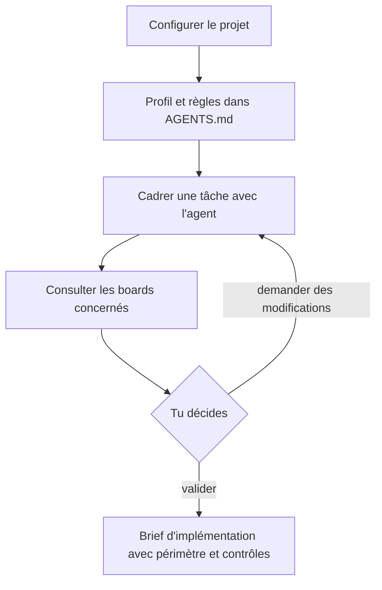

<p align="center">
  
</p>

<p align="center"><a href="README.md">English version</a></p>

OpenGuildKit est un framework open source pour les équipes qui développent avec des agents IA. Tu choisis les règles que tes agents doivent suivre et tu consultes les métiers concernés avant de valider un changement.

https://github.com/user-attachments/assets/8a6ec7e6-e7c3-4f95-bd21-6dcd1d960d8f

## Essayer la démo

Utilise Python 3.11 ou une version plus récente.

```bash
git clone https://github.com/Sandbox-podcast/OpenGuildKit.git
cd OpenGuildKit
python -m pip install -e .
python examples/request-status/replay.py
```

La [démo](examples/request-status/) crée un projet temporaire et utilise des avis préparés sur le suivi des demandes support. Lance-la dans un terminal pour comparer les avis, valider le périmètre et lire le brief d'implémentation.

## Le board des brains

Chaque métier d'un éditeur de logiciels a son brain : développement logiciel, front-end, back-end, sécurité, DevOps, QA, performance, produit, design, données et IA, marketing, communication, vente, partenariats, support client, succès client, finance, achats, juridique et conformité, RH, informatique interne, localisation, relations développeurs et documentation, confiance et sécurité des contenus, gestion de projet, opérations et direction. Un brain apporte des spécialistes avec ce que chacun vérifie, les preuves qu'il demande, les objections qu'il soulève, ses critères de décision, et les méthodes, packs de règles et normes de son métier.

Pour chaque changement, OpenGuildKit réunit les brains concernés. Chacun relit la tâche séparément, les brains répondent aux objections des autres, et tu décides avec leurs verdicts, leurs preuves et les désaccords qui restent. `openguildkit brains` les liste ; `openguildkit brains --id legal` montre ce qu'un brain connaît. Une entreprise complète un brain avec un fichier dans `.openguildkit/catalog/boards/`, ou ajoute le sien avec `openguildkit brains --new ID`. [Brains métier](docs/brains.md)

## Configurer ton projet

Depuis ton dépôt, indique ta stack, ton secteur et les métiers concernés. Le questionnaire repère les combinaisons techniques connues et te laisse choisir les méthodes que ton équipe applique. Dans un dépôt existant, `openguildkit detect` propose d'abord tes composants et leurs versions, et chaque pattern s'applique au composant qui utilise ses technologies.

```bash
openguildkit detect
openguildkit init
openguildkit preview
openguildkit check
```

`init` enregistre ton profil dans `.openguildkit/project.json` et écrit les règles dans un bloc géré de `AGENTS.md`. Il ajoute un import dans `CLAUDE.md` pour Claude Code. Les règles en vigueur sont figées dans `.openguildkit/catalog.lock.json` : après une mise à jour d'OpenGuildKit, `openguildkit update` montre ce qui changerait et `openguildkit update --apply` l'adopte. [Installe le skill](integrations/) pour répondre au questionnaire dans Claude Code ou Codex et lancer des tâches depuis la conversation.



Avec `"guard": "enforce"` dans le profil, le board n'est plus facultatif : les hooks de l'agent le rappellent à chaque demande, refusent les modifications faites par les outils d'édition de l'agent tant qu'aucune tâche n'est approuvée, et un contrôle CI exige la décision approuvée dans chaque PR. Les écritures par le shell ne passent pas par les hooks ; le contrôle CI les rattrape. Une approbation locale ne détecte que les modifications accidentelles : passez aux approbations signées si l'agent ne doit pas pouvoir approuver à votre place. [Board automatique](integrations/README.md#the-board-before-every-change)

La CLI choisit les boards et enregistre leurs avis en local. Ton agent rédige ces avis et utilise ses outils pour les recherches que tu autorises. Tu valides le périmètre dans ton terminal avant que la CLI affiche le brief d'implémentation.

Chaque brain traite la demande sous plusieurs angles. Il confronte la proposition à une alternative et te montre les preuves, les objections et les tests qui permettraient de décider. [Brains métier](docs/brains.md)

## Parcourir le catalogue

```bash
openguildkit catalog
openguildkit references
openguildkit patterns --role project-management
openguildkit patterns --role hr
openguildkit patterns --id python-fastapi-postgresql
openguildkit brains --id product
```

`catalog` liste les packs, les boards et les secteurs. L'index donne accès aux sources et aux méthodes. Chaque pattern indique quand il s'applique et quels packs alimentent `AGENTS.md`. [Références](docs/references.md) · [Choix des patterns](docs/patterns.md)

## Documentation

- [Installer les paquets d’une release GitHub](docs/install.md)

- [Vérifier une règle de catalogue en CI](examples/export-expiry/README.md)
- [Coordonner les vérifications de PR avec GitHub Actions et Jenkins](integrations/ci/README.md)

- [Architecture](docs/architecture.md) et [parcours d'une tâche](docs/workflow.md)
- [Dossiers marché et veille concurrentielle](docs/market.md)
- [Alertes de dépendances et veille des vulnérabilités](docs/alerts.md)
- [Livrables métier issus des tâches approuvées](docs/deliverables.md)
- [Storybook du projet, design system de l’entreprise et extraction](docs/storybook.md)
- [Documentation du projet et partage avec Documentalist](docs/documentation.md)
- [Outils de la stack d'entreprise, leurs serveurs MCP et leurs simulations](docs/tools.md)
- [Tests de bout en bout avec ChaosFolk, en option](integrations/chaosfolk/)
- [Contribuer](CONTRIBUTING.md), [format du catalogue](docs/catalog-format.md) et [tests](docs/testing.md)
- [Feuille de route](docs/roadmap.md) et [licence MIT](LICENSE)
