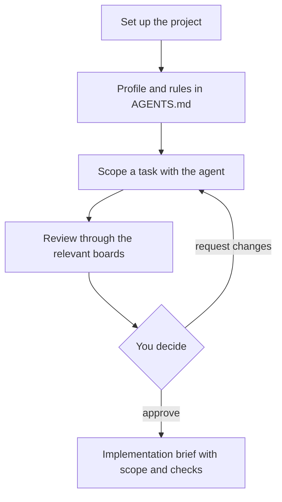

<p align="center">
  
</p>

<p align="center"><a href="README.fr.md">Version française</a></p>

OpenGuildKit is an open source framework for teams that build with AI agents. Choose the rules your agents should follow and get reviews from the disciplines affected by a change before you approve it.

https://github.com/user-attachments/assets/397e93ff-cd9f-455b-a4c0-c1425c8a5200

## Try it

Use Python 3.11 or later.

```bash
git clone https://github.com/Sandbox-podcast/OpenGuildKit.git
cd OpenGuildKit
python -m pip install -e .
python examples/request-status/replay.py
```

To install a published version instead, with its verified wheel and agent files, follow [Install a GitHub release](docs/install.md).

The [request status demo](examples/request-status/) creates a temporary project and uses prepared reviews for tracking support requests. Run it in a terminal to compare the findings, approve the scope and see the implementation brief.

## The board of brains

Each discipline of a software publisher has a brain: software development, front-end, back-end, security, DevOps, QA, performance, product, design, data and AI, marketing, communication, sales, partnerships, customer support, customer success, finance, procurement, legal and compliance, HR, internal IT, localisation, developer relations and documentation, trust and safety, project management, operations and executive leadership. A brain brings specialist lenses with what an expert of each verifies, the evidence it asks for, the objections it raises, its decision criteria and the methods, rule packs and standards of its discipline.

For every change, OpenGuildKit convenes the brains it concerns. Each one reviews the task separately, the brains answer each other's objections, and you decide with their verdicts, evidence and remaining disagreements in front of you. `openguildkit brains` lists them; `openguildkit brains --id legal` shows what one knows. A company completes a brain with a file in `.openguildkit/catalog/boards/`, or adds its own with `openguildkit brains --new ID`. [Specialist brains](docs/brains.md)

## Set up your project

From your own repository, launch the interactive questionnaire. Pick your stack, sector, rule packs and boards. In an existing repository, `openguildkit detect` proposes your components and versions first, and each pattern applies to the component where its technologies are used.

```bash
openguildkit detect
openguildkit init
openguildkit preview
openguildkit check
```

`init` saves the profile in `.openguildkit/project.json` and writes the rules in a managed block in `AGENTS.md`. It adds an import to `CLAUDE.md` for Claude Code. The catalog records in force are pinned in `.openguildkit/catalog.lock.json`: after upgrading OpenGuildKit, `openguildkit update` shows what would change and `openguildkit update --apply` adopts it. [Install the agent skill](integrations/) to answer the questionnaire in Claude Code or Codex and run tasks from the conversation.



With `"guard": "enforce"` in the profile, the board is not optional: host hooks remind the agent on every request, refuse file edits through the agent's edit tools until a task is approved, and a CI check requires the approved decision in each pull request. Writes through the shell do not go through the hooks; the CI check catches them. A local approval only detects accidental edits: use signed approvals when the agent must not be able to approve for you. [Board guard](integrations/README.md#the-board-before-every-change)

The local CLI selects the boards and records their reviews. Your agent writes the reviews and uses its own tools for any research you authorize. You approve the scope in your terminal before the CLI issues the implementation brief.

## Browse the catalog

```bash
openguildkit catalog
openguildkit references
openguildkit patterns --role project-management
openguildkit patterns --role hr
openguildkit patterns --id python-fastapi-postgresql
```

`catalog` lists the packs, boards and sectors you can use in a project. The [reference index](docs/references.md) provides summaries and source links. Rule packs contain the instructions and checks `init` writes into `AGENTS.md`.

## Documentation

- [Install a GitHub release](docs/install.md)

- [Run an executable catalog rule in CI](examples/export-expiry/README.md)
- [Coordinate pull request checks across GitHub Actions and Jenkins](integrations/ci/README.md)

- [Specialist brains and decision briefs](docs/brains.md)
- [Market dossiers and competitor watch](docs/market.md)
- [Dependency alerts and vulnerability watch](docs/alerts.md)
- [Business deliverables from approved tasks](docs/deliverables.md)
- [Project Storybook, company design system and extraction](docs/storybook.md)
- [Project documentation and sharing with Documentalist](docs/documentation.md)
- [Tools of the company stack, their MCP servers and mocks](docs/tools.md)
- [Stack matching and work methods](docs/patterns.md)
- [Optional ChaosFolk end-to-end replays](integrations/chaosfolk/)

- [Architecture](docs/architecture.md) and [task workflow](docs/workflow.md)
- [Contributing](CONTRIBUTING.md), [catalog format](docs/catalog-format.md) and [testing](docs/testing.md)
- [Roadmap](docs/roadmap.md) and [MIT license](LICENSE)
