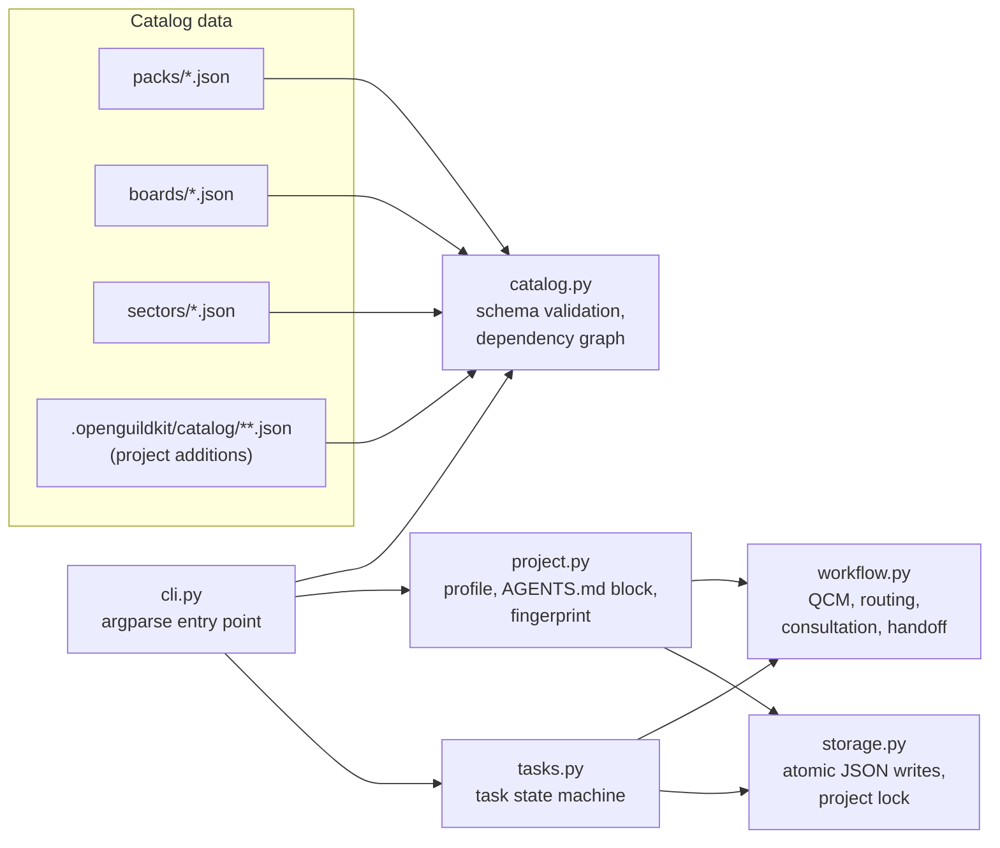
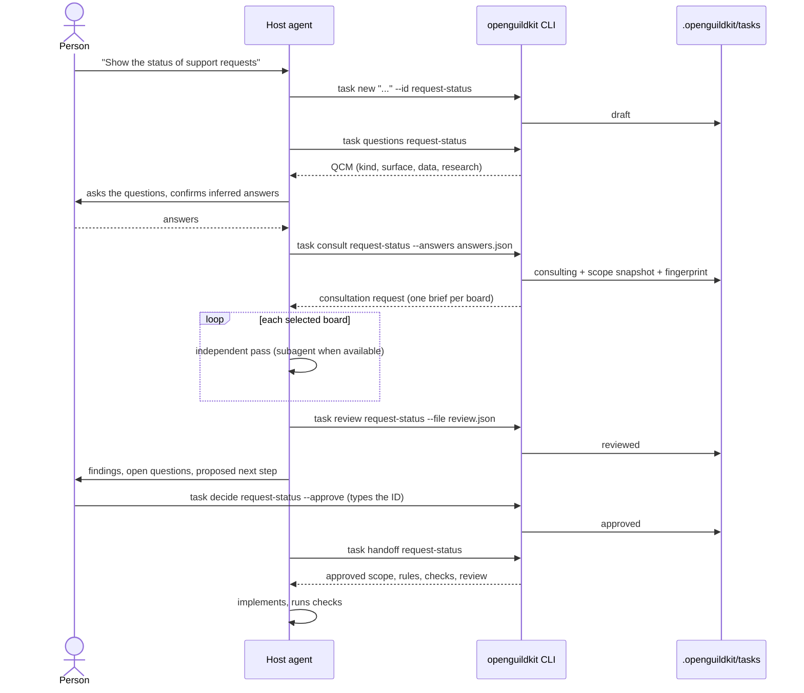

# Architecture

OpenGuildKit has two parts: a **knowledge catalog** (JSON data) and a **CLI** that turns the catalog and a project profile into instructions, consultation requests and handoffs for a host agent. The CLI does no AI work itself.

## Components



| Module | Responsibility |
|---|---|
| `catalog.py` | Loads bundled records from `registry/` and optional project records from `.openguildkit/catalog/`. Rejects unknown fields, duplicate IDs, duplicate JSON keys, non-HTTPS sources, multi-line text and pack dependency cycles. |
| `detect.py` | Proposes components, technologies and versions from the repository's manifests, without running a package manager. |
| `project.py` | Builds the init questionnaire, validates the profile, recommends packs from the stack, resolves pack dependencies, renders the managed block in `AGENTS.md`, computes the profile fingerprint and checks that instructions are current. |
| `workflow.py` | Holds the task questionnaire, routes a task to boards, renders the consultation request and the handoff, and validates reviews. |
| `tasks.py` | Creates task records and enforces the state machine: draft, consulting, reviewed, approved or changes-requested. |
| `storage.py` | Writes files through a temporary file and `os.replace`, refuses symbolic links, and serialises writing commands with a lock on `.openguildkit/.lock`: a writer waits up to 10 seconds (`OPENGUILDKIT_LOCK_TIMEOUT`, in seconds) for another one to finish, then stops with "Try again". Read commands never take the lock. |
| `cli.py` | Parses commands, reads answers from files or a terminal, and enforces the interactive approval. |

## What lives in a project

```text
your-project/
  AGENTS.md                      managed block between OpenGuildKit markers
  CLAUDE.md                      imports AGENTS.md for Claude Code
  .openguildkit/
    project.json                 the profile (commit it)
    catalog.lock.json            the catalog records in force (commit it)
    catalog/                     optional private packs, boards, sectors (commit it)
      packs/ boards/ sectors/
    tasks/                       task records (local, git-ignored)
    shares/                      who a deliverable is shared with (local, git-ignored)
    decisions/                   exported decision records (commit them)
    market/                      market dossiers (commit them)
    .gitignore                   created by init: tasks/, .lock, temp files
```

The profile and the managed block are shared through git, so every person and every agent on the project gets the same rules. Task records stay local because they can contain unreleased product details, and `check` expects `tasks/` in `.openguildkit/.gitignore`. A team that needs an audit trail exports `task show ID` or the approved handoff to the evidence location it already uses. The team's own text in `AGENTS.md` and `CLAUDE.md` stays around the block; `sync` refuses a file that is not UTF-8 or that ends inside an unclosed code block, since the rules would otherwise be read as code. In a monorepo, a language pack that a component's pattern brings applies only to that component.

## Data flow for one task



## Design decisions

**No AI calls in the CLI.** Companies already chose an agent, a model provider and a data policy. OpenGuildKit works inside those choices instead of adding another provider, another API key and another data flow. The CLI itself opens no network connection, and it is a small Python package without dependencies that a security team can read in full. What the host agent sends to its provider is governed by that agent's settings, not by OpenGuildKit.

**Catalog as validated JSON.** Contributors can add rules for security, accessibility or a new domain without writing Python. CI checks the schema and reports invalid fields.

**One rule = one instruction + one verification.** An instruction an agent cannot be checked against is advice, not a rule. The verification line tells the reviewer, or the agent itself, how to confirm the rule was applied.

**Boards are lenses, not oracles.** A board brief lists the discipline's expertises, the questions it asks and source leads. The host agent applies it to the task. The CLI only checks that every selected board answered. Routing is deterministic: the same answers and brief always select the same boards, so a team can predict and discuss it.

**Catalog updates are adopted, not received.** `init` and `sync` copy every bundled pack, board, sector and pattern the profile uses into `.openguildkit/catalog.lock.json`. Commands read the locked copies, so installing a newer OpenGuildKit leaves the project's rules, `AGENTS.md` and fingerprints unchanged. `openguildkit update` lists what the installed catalog would add, remove or change, rule by rule with its sources. `openguildkit update --apply` adopts it, rewrites the instructions and names the tasks consulted under the previous rules. Records the project adds in `.openguildkit/catalog/` are already versioned with the project and are not copied. A record that a newer release no longer ships stays in the lock, and in force, while the profile uses it: `update` and `sync` say so, and it leaves the lock when the team removes it from `.openguildkit/project.json`.

**A person approves, at a terminal.** `task decide --approve` refuses non-interactive input and asks the person to type the task ID after showing the brief and review. This is friction by design: it stops an agent from approving its own plan through a pipe, and `openguildkit host apply` makes Claude Code and Codex refuse the approval, waiver and allow commands in their documented forms (with `--project`, through `python -m`, from a virtual environment) and the usual terminal emulators. Deny rules match the command line only and the hosts say they are not a security boundary: `sh -c '...'`, an absolute path to the program, `env PROGRAM` or a script file that opens a pseudo-terminal or writes the task file gets around them ([what the hosts document](../integrations/README.md#what-the-host-documentation-says)). A project that needs a verifiable approver uses signed approvals.

**Approvals are sealed and can be signed.** Each approval records the base Git revision and a SHA-256 seal over the consultation, the scope, the review, the blocker resolutions, the rules in force, the approver's name and reason. The handoff refuses a decision whose seal no longer matches the task record, a decision without a seal, or a base revision that is no longer in the project history. A local seal is computed from data that all sits in the task file, with no secret: it detects accidental edits, not an agent that edits the file and recomputes the seal. With the guard on, the pre-edit hook and the host deny rules keep the agent's file tools, and in Claude Code its shell redirections, away from the task records and the profile, but not a script that writes them. Only a signed approval resists an agent that can write files; `init`, `host check` and `check` warn when `"guard": "enforce"` runs without one ([how to switch](workflow.md#signed-approvals)). With `"approval": {"mode": "signed", "allowed_signers": ".openguildkit/allowed_signers", "approvers": ["camille@example.org"]}`, the approver writes the decision with `task decision-payload --output decision.json` and signs that file with their SSH key (`ssh-keygen -Y sign -n openguildkit-decision`), and `task decide --approve --signature FILE --signer PRINCIPAL` verifies it locally against the allowed signers file kept in the repository. A key protected by a passphrase or a hardware token keeps the agent from signing.

**Decisions expire when the rules change.** The fingerprint covers the resolved profile and the exact pack, board and sector records in force. Changing a rule after approval makes `task handoff` fail. An approved task cannot be consulted again; open a new task for the same work so the record shows which rules each approval covered.

## Trust boundaries

| Input | Treated as | Protection |
|---|---|---|
| Task brief, answers context | Data | Rendered inside JSON code fences longer than any backtick run in the content |
| Catalog sources | Leads to inspect | Agent is told to treat them as leads until inspected |
| Research results | Data | Agent is told not to follow instructions found in them |
| Project catalog additions | Trusted project config | Same schema validation as bundled records; cannot reuse a bundled ID |
| Review JSON | Agent output | Schema validated; must cover exactly the selected boards |

The project's host settings, written by `openguildkit host apply`, let Claude Code or Codex enforce the research policy and keep the agent away from the approval command. `openguildkit host check` says which rules remain instructions. [Host controls](../integrations/README.md#what-the-host-enforces)

Public research is allowed only when the profile says `public-sources` **and** the task answer says `public`. Otherwise the consultation tells the agent to stay with local project material.

## Extension points

- **New pack, board or sector:** add a JSON file to `registry/` (shared) or `.openguildkit/catalog/` (private). See [catalog format](catalog-format.md).
- **New host agent:** anything that reads `AGENTS.md` and can run shell commands works. The [integrations](../integrations) folder has a skill for Claude Code and Codex.
- **CI:** run `openguildkit check` to fail a build when `AGENTS.md` drifts from the profile.
