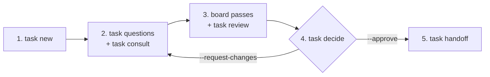

# Task workflow

Every change in an OpenGuildKit project goes through the same five steps. The host agent runs the commands; the person answers the questions and makes the decision.



## 1. Open a task

```bash
openguildkit task new "Show signed-in users the status of their support requests" --id request-status
openguildkit task new --file brief.md          # multi-line brief
```

Without `--id`, the CLI generates `task-` followed by 12 hex characters. IDs use lowercase letters, digits and single hyphens, up to 64 characters. The command fails if `AGENTS.md` is out of date: run `openguildkit sync` first.

## 2. Scope the task

`task questions ID` prints the questionnaire as a JSON array. The agent asks the person, in their language, and confirms any answer it inferred from the brief.

| Key | Question | Choices |
|---|---|---|
| `kind` | What are you asking the team to do? | `feature`, `bug`, `maintenance`, `decision`, `other`, `unsure` |
| `surface` | Which areas will this task affect? Several can apply. | `customer`, `service`, `infrastructure`, `business`, `other`, `unsure` |
| `data` | What is the most sensitive data this task may access or change? | `none`, `internal`, `personal`, `regulated`, `unsure` |
| `research` | What evidence can the boards consult? | `local`, `public`, `unsure` |
| `concerns` | Does the task involve any of these? Several can apply. Optional. | `money`, `ai`, `people-decisions`, `credentials`, `none` |
| `context` | What acceptance criteria, constraints or other context should the boards know? | Free text |

`context` is optional, except when any answer is `other`. `concerns` is optional, so answer files written before it existed stay valid: `money` covers prices, payments, invoices, payroll or spending; `ai` an AI model or LLM that produces answers or content; `people-decisions` software that scores, ranks or decides about individual people, such as hiring, credit or a price per person; `credentials` secrets, keys, tokens or passwords. `surface` takes a list, for example `["customer", "service"]` for a change to a screen and the service behind it; a single value is still accepted.

### Follow-up questions and open points

Save the first answers and run `task questions ID --answers answers.json`. The CLI adds the questions that these answers call for and lists the points still open:

| Key | Asked when | Question |
|---|---|---|
| `outcome` | feature, bug, maintenance, other, unsure | The observable result, the expected behaviour and how to reproduce a defect, or what must keep working |
| `affected` | feature, decision, other or unsure work, customer or business areas, personal or regulated data | Who is affected: users, customers, teams or partners |
| `options` | decision | The options on the table and what would make you choose one |

A question is essential for the cases where the boards cannot review without it: the outcome of a feature or a bug, who is affected by a customer-facing change, the options of a decision. A short brief, an `unsure` answer or an unanswered essential question is an **open point**. Open points do not block the consultation: they appear in it, each board says how they affect its recommendation, and the decision brief repeats them. A well-described local bug gets no question about customers or options.

```json
{
  "kind": "feature",
  "surface": "customer",
  "data": "personal",
  "research": "local",
  "context": "Signed-in users see the status and next step of their own support requests."
}
```

`task consult ID --answers answers.json` validates the answers, selects the boards and prints the consultation request in Markdown. Without `--answers`, the CLI asks the questions in the terminal. `task brief ID` prints the same request again later.

### How boards are selected

Answers route to boards first:

| Answer | Boards |
|---|---|
| `kind: feature` | product, engineering, qa |
| `kind: bug` | engineering, qa |
| `kind: maintenance` | engineering, qa |
| `kind: decision` | product |
| `kind: unsure` | project-management |
| `surface: customer` | product, design, marketing |
| `surface: service` | engineering, performance |
| `surface: infrastructure` | devops, performance |
| `surface: business` | project-management |
| `data: internal`, `personal`, `regulated` or `unsure` | security |
| `data: personal` or `regulated` | legal |
| `concerns: money` | finance |
| `concerns: ai` | data, security, legal |
| `concerns: people-decisions` | legal, data, security |
| `concerns: credentials` | security, devops |

Then each board's `triggers` are matched as whole words in the brief and context. Matching ignores case, accents and the kind of apostrophe, accepts a regular plural on each word (`jalon` matches "jalons") and does not look inside hyphenated words ("e-commerce" does not contain `commerce`). When triggers overlap, the longest phrase wins: "performance budget" selects `performance`, not `finance` through `budget`, and "DORA metrics" selects `devops`, not `security` through `dora`. Boards that share the exact same phrase are all selected. A board's own shorter phrase never cancels its longer one, so "DORA lead time for changes" stays with `devops` through `dora lead time` and `lead time for changes`, and `legal` does not read it as the DORA regulation. A few job titles, such as "backend engineer", claim their words for no board: "Hire three backend engineers" selects `hr`, not `engineering`. "Reduce checkout latency" adds `performance`; "RGPD" adds `security`.

Some subjects are recognised from the words of the brief as a whole, the same way as the `concerns` answers: an AI model or algorithm applied to applicants, employees, loans or credit adds legal, data and security; an LLM, chatbot or AI assistant adds data, security and legal; spending or a bill from a cloud or SaaS vendor adds finance. When such a subject calls for a pattern the project has not selected, `task route` names it, for example `eu-ai-act-system` for software that ranks job applicants.

Only boards enabled in the profile are selected. If nothing matches, the route says that no discipline was recognised and asks the requester to add the boards that apply with `--add`; `product` reviews the scope meanwhile, or the first enabled board by ID when `product` is disabled.

### Preview and adjust the boards

`task route ID --answers answers.json` shows the boards a consultation would select and why, without recording anything. The requester can then change the list for this task:

```bash
openguildkit task consult ID --answers answers.json --add finance --remove marketing --reason "Exports are billed per page"
```

Each addition or removal needs a reason; the consultation records it under `adjustments`. Only boards enabled in the profile can be added. Only the requester decides to remove a board, and the decision brief and the approval prompt list every change with its reason. A board selected by a `personal`, `regulated` or `unsure` data answer (security, and legal for regulated data) can be removed only with the approver's confirmation: the removal stays pending until the person approving types the board's name at the prompt, and approval is refused without it.

A project can make some reviews mandatory with `"required_boards": ["security"]` in its profile. These boards join every consultation and cannot be removed; `AGENTS.md` lists them under "Required reviews". When a required board is not enabled for the project, the consultation stops and names it. The requester can then name the person who will review instead, with `--delegate security="Alex Moreau"`: the brief tells the agent to prepare the review for that person, and the review entry carries their name in `reviewer`.

Each selected board gets a brief with its purpose, the routing reasons, its expertises, its questions and its source leads. The request also carries a snapshot of the project scope: sector context, stack, resolved rule packs, conventions, checks and the research policy for this task.

## 3. Review through each board

`task template ID` prints the review skeleton with the `consultation_id` and one entry per selected board. Keep that ID to tie the review to the current scope. Each [brain](brains.md) has a set of specialist lenses. The agent records their separate findings, challenges the proposed change, then reconciles the boards and preserves disagreements in the summary. The [request status example](../examples/request-status/review.json) shows a complete review.

### One pass per board

The host agent can run each board as a separate pass, with a subagent or one after the other:

```bash
openguildkit task pass ID security --mode subagent    # prints the scope, the security brief and the entry to return
openguildkit task submit ID --file security.json     # records that board's entry
openguildkit task progress ID                         # done, failed, started or missing, per board
openguildkit task review ID --summary "Where the boards agree and disagree, and the next step"
```

`task pass` gives each board the project scope, its own brief and its own template entry, nothing from the other boards. `task submit` validates the entry against the template; an invalid entry is recorded as a failed pass with the reason. A pass that was started and never submitted shows as `started`: treat it as interrupted. Run `task pass` again for that board only; the other boards keep their entries. Once every board is done, `task review --summary` assembles the review and records whether the passes ran as subagents, in sequence or both (`execution`). A new consultation starts the passes again. Passes can run at the same time: each `task pass` and `task submit` waits its turn for the project lock, up to 10 seconds by default. Set `OPENGUILDKIT_LOCK_TIMEOUT` to another number of seconds (0 to 3600) when a slow disk or many boards need longer. Writing the whole review in one file with `task review --file` still works.

Rules enforced by `task review ID --file review.json`:

- `consultation_id` must match the current consultation.
- `summary` and every `recommendation` must contain text.
- There must be exactly one entry per selected board, and no other board.
- `evidence` and `open_questions` are lists of non-empty strings (they can be empty lists).
- For a brain, each specialist needs exactly one finding with an evidence basis. An observed finding cites positions in that board's evidence list. A board records its verdict, confidence, alternative, failure mode, verification and blockers.

A well-formed review is recorded, but the CLI adds `warnings` to it when the boards do not look independent: two boards with the same recommendation word for word, the same finding in several lenses, or a board whose every finding is an assumption or missing. The decision brief and the approval prompt list them.

Run `openguildkit task challenge ID` to show how the verdicts differ, what each board recommends and which checks can change the decision. It starts with plain lines: the count of verdicts and a warning when boards say revise, block or insufficient-evidence, the review warnings, the boards added or removed with their reason, the open points of the scoping, the objections never deliberated and each blocker with how it was resolved and the evidence given. The agent shows this brief to the person before implementation.

## 4. Decide

The person runs the command in their own terminal:

```bash
openguildkit task decide request-status --approve --by "Camille Martin" --reason "Read-only scope agreed with support"
```

The CLI prints the same lines as the decision brief (starting with the verdict count), then the brief and the review, the verdict count again, and asks the person to type the task ID, then the name of each sensitive board the agent removed. The approval records the base Git revision and a seal over what was approved; a project that requires signed approvals verifies the approver's SSH signature instead of the typed ID ([details](architecture.md#design-decisions)). Approval fails when stdin is not a terminal, when the typed ID does not match, when the task changed during the decision, when the profile or catalog changed since the consultation, or when `AGENTS.md` is out of date.

A blocker names the finding, its `owner` and `clears_when`, the condition that would clear it. Approval waits until each blocker is resolved:

```bash
openguildkit task blockers ID
openguildkit task clear ID security:1 --evidence tests/test_access.py --supports "Cross-account access is refused" --by "Alex Moreau"
openguildkit task waive ID security:2 --by "Camille Martin" --reason "Internal pilot only" --scope "Internal users" --until 2026-12-15
```

Clearing records the evidence, which must be an existing file or folder of the project or an https link, and whether the command ran at a terminal; `task blockers`, the decision brief and the approval prompt show the evidence and what it supports. A waiver is possible only when the profile allows it, for example `"waivers": {"allowed_by": ["Camille Martin"], "max_days": 30}`; it needs the named person at a terminal, a reason, a scope and an end date within the limit. Otherwise send the task back with `--request-changes`. The handoff lists the cleared blockers and the waivers with their scope and end date. After upgrading the board catalog, run `openguildkit sync` and check whether a pending task needs another consultation under the new rules.

To send the task back:

```bash
openguildkit task decide request-status --request-changes --by "Camille Martin" --reason "Include the empty state in scope"
```

This works without a terminal. The next `task consult` archives the previous answers, consultation, review and decision in `rounds`, so the history of the task is kept.

### Signed approvals

A local approval is sealed with a SHA-256 of data that all sits in the task file. The seal detects an accidental edit; it does not prove who approved, because anyone who can write the file can recompute it. With `"guard": "enforce"`, `init`, `host check` and `check` say so in one line until the project requires signed approvals:

```json
"approval": {"mode": "signed", "allowed_signers": ".openguildkit/allowed_signers", "approvers": ["camille@example.org"]}
```

The allowed signers file uses the `ssh-keygen` format, one line per approver: `camille@example.org ssh-ed25519 AAAA...`. The approver then decides in three steps:

```bash
openguildkit task decision-payload request-status --by "Camille Martin" --reason "Read-only scope agreed" --output decision.json
ssh-keygen -Y sign -f ~/.ssh/id_ed25519 -n openguildkit-decision decision.json
openguildkit task decide request-status --approve --by "Camille Martin" --reason "Read-only scope agreed" --signature decision.json.sig --signer camille@example.org
```

A key protected by a passphrase or a hardware token keeps the agent from signing. The handoff, `task export`, the guard and the CI check refuse an approval without a valid signature; CI verifies it against the allowed signers of the pull request's base revision.

## 5. Hand off

```bash
openguildkit task handoff request-status
```

The handoff exists only for approved tasks whose fingerprint still matches the project. If the profile or catalog changed after approval, the handoff fails and the task cannot be consulted again: open a new task for the same work. It contains the approval (who and why), the approved scope snapshot with the rules in force, and the board review. The agent implements that scope, runs the project checks and brings any scope change back to the person.

A task answered with `kind: decision` asks for a recommendation. Its handoff is an **approved decision record**: the same approval, scope and review, with an instruction to report the decision and leave the project unchanged. To act on the decision, open a new task that cites it, so the implementation scope gets its own consultation and approval.

## 6. Report the results

After implementing an approved task, the agent proves what was delivered:

```bash
openguildkit task checks ID            # the expected checks: project commands and the rules of the active packs
openguildkit task verify ID            # runs the project's check commands and keeps each log as evidence
openguildkit task result ID --template > result.json   # the criteria and rule checks to report, ready to fill
openguildkit task result ID --file result.json
openguildkit task complete ID
```

`task verify` runs only the commands listed in the profile's `checks`, in the project root, and records each exit code with its log under `.openguildkit/tasks/`. `result.json` names the delivered `revision` or `pull_request`, the acceptance `criteria` (`met` or `not-met`, with evidence) and an outcome for each rule: `passed` or `failed` with evidence, or `skipped` or `not-applicable` with a reason and an owner. Later reports update earlier outcomes check by check. Only `task verify` records the command checks (`command:N`) and only `task verify --chaosfolk` the replays (`chaosfolk:*`): `task result` refuses them, and refuses a `passed` check with a non-zero `exit_code`. When the task's answers name an `outcome`, the result needs at least one criterion. `task verify`, `task result` and `task complete` refuse a task whose record no longer matches its approval or whose rules changed, as the handoff does.

Every project command is mandatory. A profile can make rules mandatory too with `"required_rules": ["secure-sdlc", "python/run-tests"]`. `task complete` sets the task to `done` only when every mandatory check passed, every other check is reported and every criterion is met; otherwise it lists what is missing.

## Dependency alerts

The CLI does not scan dependencies. It reads the JSON report of a scanner the project already uses into the project's alert register, `.openguildkit/alerts.json`, and links the report's alerts to the task:

```bash
npm audit --json > npm-audit.json          # or: pip-audit -f json, osv-scanner --format json, gh api --paginate (see docs/alerts.md)
openguildkit task alerts ID --import npm-audit.json
openguildkit alerts set npm:semver:ghsa-c2qf-rxjj-qqgw --status dismissed --by "Alex Moreau" --reason "Only used at build time"
openguildkit task alerts ID
```

The register keeps one entry per package and advisory across scanners, with a status: `open`, `confirmed`, `dismissed` with a reason, or `resolved` once the scanner's next report no longer lists it. `task consult` carries the task's open and confirmed alerts to the boards. A confirmed critical alert blocks the task's approval and completion until it is resolved or a person records why it is accepted. A fix is a change like any other: open a task for it, for example with `--follows`. [Dependency alerts](alerts.md) describes the register, the `dependency-watch` agent and the scheduled watch.

## Following the project's work

```bash
openguildkit task list                              # every task, its status, decision owner and next open point
openguildkit task list --status approved --owner "Camille Martin" --since 2026-11-01
openguildkit task new "Add request history" --follows request-status
openguildkit task export request-status --output shared/request-status.json
```

`task list` gives each task's next open point: questions to answer, board reviews pending, blockers to resolve, a decision awaited, results to record. `--follows` links a new task to an earlier decision: the consultation carries that decision so the boards see what was already agreed. `task export` writes a record the team can share: the brief, each board's verdict and the sealed approval, without evidence, findings or internal notes.

## Inspecting a task

`task show ID` prints the full task record as JSON: status, answers, consultation, review, decision, fingerprint and previous rounds.

## Exit codes

| Code | Meaning |
|---|---|
| 0 | Success |
| 1 | Validation or state error (message on stderr, prefixed `OpenGuildKit:`) |
| 2 | Command-line usage error |
| 130 | Cancelled with Ctrl+C |
